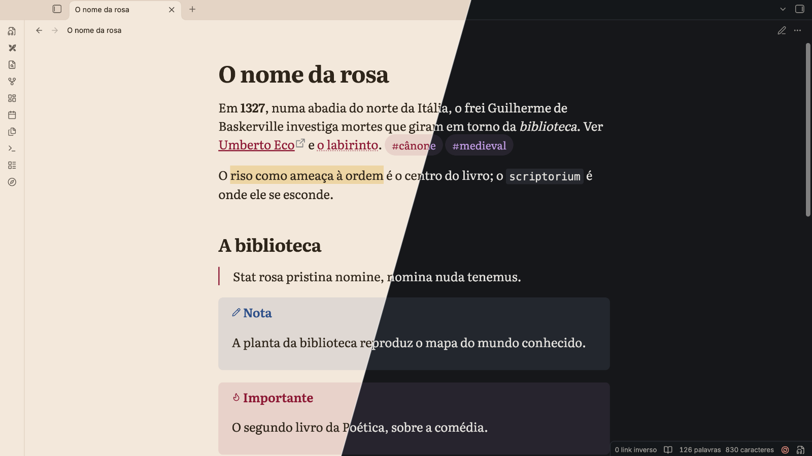

# Lareia

*Português abaixo · English below.*

## Português

O tema do Obsidian da [Lareia](https://lareia.app) — a mesma folha, a mesma tinta
e a mesma letra dos apps Leitor e Codex, gerados da mesma fundação de CSS.

**Os dois modos**

- **Claro** é o sépia da Lareia: papel cor de pergaminho com subtom rosado, tinta
  quente e a rubrica carmesim como acento.
- **Escuro** é o escuro da Lareia: papel frio e baixo, tinta cor de osso e a
  ametista como acento.
- **Opção:** com o plugin [Style Settings](https://github.com/mgmeyers/obsidian-style-settings),
  *Lareia → Papel claro no modo claro* troca o sépia pelo claro (papel quase branco).

**A letra.** Literata no texto e nos cabeçalhos, Inter na interface (a Inter que o
próprio Obsidian traz) e a monoespaçada do sistema no código. Os cabeçalhos seguem
a escala de letra da Lareia, em proporção ao tamanho de fonte que você escolher.

**Contraste.** Todo texto — normal, secundário, tênue, acento, os títulos dos
callouts, a sintaxe do código — passa de 4,5:1 sobre o papel e sobre a barra
lateral, nos três papéis.

**Sem rede.** A Literata vai embutida no `theme.css`; o tema não carrega nada de fora.

Requer Obsidian 1.13.0 ou mais novo. Não afiliado ao Obsidian.

## English

The Obsidian theme of [Lareia](https://lareia.app) — the same paper, ink and type as
the Leitor and Codex apps, generated from the same CSS foundation.

**Two modes**

- **Light** is Lareia's sepia: parchment with a rosy undertone, warm ink and a crimson
  rubric as the accent.
- **Dark** is Lareia's dark: cool, low paper, bone-coloured ink and amethyst as the accent.
- **Option:** with the [Style Settings](https://github.com/mgmeyers/obsidian-style-settings)
  plugin, *Lareia → Papel claro no modo claro* swaps sepia for Lareia's light paper.

**Type.** Literata for text and headings, Inter for the interface (the Inter Obsidian
already ships) and the system monospace for code. Headings follow Lareia's type scale,
relative to the font size you choose.

**Contrast.** All text — normal, muted, faint, accent, callout titles, code syntax —
is at least 4.5:1 on the page and on the sidebar, in all three papers.

**No network.** Literata is embedded in `theme.css`; the theme loads nothing remote.

Requires Obsidian 1.13.0 or newer. Not affiliated with Obsidian.

## Licenses

- Theme: MIT — see [LICENSE](LICENSE).
- Literata, embedded in `theme.css`: Copyright 2017 The Literata Project Authors,
  SIL Open Font License 1.1 — see [OFL.txt](OFL.txt). The font is not covered by the MIT license.
